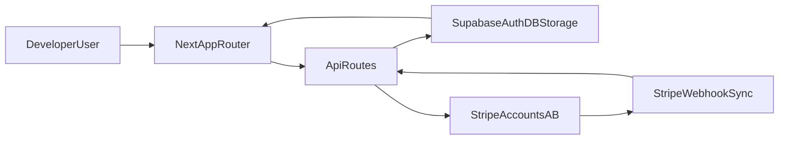

# J-Node Sales

Plataforma administrativa de cobros y ventas para J-Node, construida con Next.js, Supabase y Stripe (multi-cuenta).

## Tabla de contenido

- [Vision general](#vision-general)
- [Arquitectura](#arquitectura)
- [Stack tecnologico](#stack-tecnologico)
- [Mapa funcional del proyecto](#mapa-funcional-del-proyecto)
- [Estructura del repositorio](#estructura-del-repositorio)
- [Requisitos previos](#requisitos-previos)
- [Onboarding local](#onboarding-local)
- [Variables de entorno](#variables-de-entorno)
- [Scripts disponibles](#scripts-disponibles)
- [Flujos criticos del sistema](#flujos-criticos-del-sistema)
- [Permisos y seguridad](#permisos-y-seguridad)
- [Contribucion](#contribucion)
- [Troubleshooting](#troubleshooting)
- [Estado actual y limitaciones](#estado-actual-y-limitaciones)

## Vision general

J-Node Sales centraliza operaciones de:

- autenticacion y acceso por roles
- visualizacion de transacciones y dashboard
- asignacion de transacciones a sellers
- gestion de saldos y payouts
- configuracion de perfil, equipo y metodos de pago

Este README esta orientado a colaboradores externos que necesitan entender el sistema rapidamente y empezar a contribuir con bajo riesgo.

## Arquitectura



Resumen de capas:

- `src/app`: UI (App Router) y API routes.
- `src/lib`: integraciones (Supabase, Stripe), auth, permisos y utilidades de dominio.
- `src/hooks`: lectura/mutacion de datos con React Query.
- `supabase/schema.sql`: modelo de datos, funciones SQL, politicas y RLS.

## Stack tecnologico

- **Framework**: Next.js 15 (App Router)
- **UI**: React 18 + Tailwind CSS + Radix/shadcn
- **Datos y auth**: Supabase SSR + Supabase JS
- **Pagos**: Stripe (cuentas A/B)
- **Estado remoto**: TanStack React Query
- **Validacion**: Zod + React Hook Form
- **Tipado**: TypeScript (modo strict)

## Mapa funcional del proyecto

### Rutas de pagina (`src/app`)

**Publicas**

- `/`
- `/payment-methods`
- `/payment-methods/airtm`
- `/payment-methods/binance`
- `/payment-methods/banco-qr`

**Auth**

- `/auth/login`
- `/auth/forgot-password`
- `/auth/reset-password`
- `/auth/update-password`
- `/auth/invite-password`
- `/auth/sign-up-success`
- `/auth/error`
- `/auth/unauthorized`

**Admin**

- `/admin/onboarding`
- `/admin/dashboard`
- `/admin/transactions`
- `/admin/transactions/jnode`
- `/admin/transactions/jnode/[id]`
- `/admin/transactions/vascruz`
- `/admin/transactions/vascruz/[id]`
- `/admin/balances`
- `/admin/balances/payouts`
- `/admin/payouts/[id]`
- `/admin/settings`
- `/admin/settings/profile`
- `/admin/settings/team`
- `/admin/settings/team/[id]`
- `/admin/settings/payment-methods`

### API routes (`src/app/api`)

**Auth / Stripe**

- `GET /api/auth/confirm`
- `POST /api/stripe/sync`
- `POST /api/webhooks/stripe`

**Admin**

- `GET /api/admin/dashboard`
- `GET /api/admin/balances`
- `GET /api/admin/transactions`
- `GET /api/admin/transactions/[id]`
- `POST /api/admin/transactions/[id]/assign`
- `DELETE /api/admin/transactions/[id]/assign`
- `GET /api/admin/payouts`
- `POST /api/admin/payouts`
- `GET /api/admin/payouts/[id]`
- `PATCH /api/admin/payouts/[id]`
- `DELETE /api/admin/payouts/[id]`
- `GET /api/admin/payouts/payment-methods`

**Settings**

- `GET/PATCH /api/settings/profile`
- `PATCH /api/settings/profile/email`
- `GET/POST /api/settings/payment-methods`
- `PATCH/DELETE /api/settings/payment-methods/[id]`
- `POST /api/settings/payment-methods/upload-qr`
- `GET /api/settings/team/roles`
- `GET /api/settings/team/members`
- `GET/PATCH /api/settings/team/members/[id]`
- `GET /api/settings/team/invitations`
- `POST /api/settings/team/invite`
- `POST /api/settings/team/invitations/[id]/revoke`

### Modulos clave (`src/lib` y `src/hooks`)

**Integracion y seguridad (`src/lib`)**

- Supabase: `src/lib/supabase/{client,server,admin,middleware}.ts`
- Stripe: `src/lib/stripe/{client,transactions}.ts`
- Auth y permisos: `src/lib/auth/*`
- Cifrado metodos de pago: `src/lib/crypto.ts`, `src/lib/payment-methods/crypto.ts`
- Navegacion por rol: `src/lib/navigation/admin-nav.ts`

**Data layer frontend (`src/hooks`)**

- `src/hooks/dashboard/use-dashboard.ts`
- `src/hooks/transactions/use-transactions.ts`
- `src/hooks/balances/use-balances.ts`
- `src/hooks/payouts/use-payouts.ts`
- `src/hooks/settings/use-profile-settings.ts`
- `src/hooks/settings/use-payment-methods.ts`
- `src/hooks/settings/use-team-management.ts`
- `src/hooks/auth/*`

## Estructura del repositorio

```text
jnode-sales/
  src/
    app/                  # Paginas y API routes (Next App Router)
    components/           # UI compartida y componentes de dominio
    hooks/                # Queries/mutations y estado de datos
    lib/                  # Auth, permisos, Stripe, Supabase, utilidades
    middleware.ts         # Proteccion de rutas y redirects por sesion/rol
  public/                 # Assets estaticos
  supabase/
    schema.sql            # Esquema SQL, funciones y politicas RLS
  docs/                   # Documentacion complementaria
  .env.example            # Plantilla de variables de entorno
```

## Requisitos previos

- Node.js 20+ (recomendado LTS)
- npm
- Proyecto Supabase con credenciales validas
- Credenciales Stripe para cuentas configuradas

## Onboarding local

1. Clonar repositorio.
2. Instalar dependencias:

```bash
npm install
```

3. Crear entorno local desde plantilla:

```powershell
Copy-Item .env.example .env.local
```

4. Completar variables en `.env.local`.
5. Ejecutar aplicacion:

```bash
npm run dev
```

6. Abrir `http://localhost:3000`.

7. Validacion minima recomendada:

```bash
npm run lint
npm run build
```

## Variables de entorno

Base oficial: `.env.example`.

### Requeridas para funcionamiento

**Supabase**

- `NEXT_PUBLIC_SUPABASE_URL`
- `NEXT_PUBLIC_SUPABASE_PUBLISHABLE_KEY`
- `SUPABASE_SERVICE_ROLE_KEY`

**Cifrado**

- `PAYMENT_ENCRYPTION_KEY` (64 caracteres hex, AES-256-GCM)

**Stripe (multi-cuenta)**

- `STRIPE_ACCOUNT_A_EXTERNAL_ID`
- `STRIPE_ACCOUNT_A_SECRET_KEY`
- `STRIPE_ACCOUNT_A_WEBHOOK_SECRET`
- `STRIPE_ACCOUNT_B_EXTERNAL_ID`
- `STRIPE_ACCOUNT_B_SECRET_KEY`
- `STRIPE_ACCOUNT_B_WEBHOOK_SECRET`

### Recomendadas

- `NEXT_PUBLIC_SITE_URL`: recomendada para construir enlaces absolutos de invite/reset de forma consistente entre entornos.

### Notas de seguridad

- Nunca expongas ni compartas `SUPABASE_SERVICE_ROLE_KEY`.
- No commitees `.env.local`.
- Usa secretos de prueba en desarrollo y secretos live solo en produccion.
- Los `*_EXTERNAL_ID` deben existir en `public.stripe_accounts`.

## Scripts disponibles

- `npm run dev`: inicia entorno de desarrollo.
- `npm run build`: compila para produccion.
- `npm run start`: levanta build de produccion.
- `npm run lint`: ejecuta ESLint.

## Flujos criticos del sistema

### 1) Auth y onboarding

- El middleware valida sesion y rol para rutas `/admin/**`.
- Si el onboarding esta incompleto, redirige a `/admin/onboarding`.
- Las rutas de auth gestionan login, recovery e invitaciones.

### 2) Ingestion de transacciones Stripe

- **Webhook**: `POST /api/webhooks/stripe` valida firma y persiste eventos.
- **Sync manual**: `POST /api/stripe/sync` trae `payment_intents` historicos.
- Mapeo/normalizacion en `src/lib/stripe/transactions.ts`.

### 3) Operacion financiera (balances y payouts)

- Dashboard y balances salen de APIs admin con filtros por cuenta/periodo.
- Payouts tienen reglas de estado y permisos por rol.
- Metodos de pago se guardan con cifrado de campos sensibles.

## Permisos y seguridad

- Roles principales: `owner`, `admin`, `seller`, `analyst`, `viewer`.
- Guards server-side en `src/lib/auth/require-auth.ts`.
- Guards de API en `src/lib/auth/api-auth.ts`.
- Politicas de datos en `supabase/schema.sql` (RLS y funciones SQL).
- Proteccion adicional de rutas en `src/middleware.ts` y `src/lib/supabase/middleware.ts`.

## Contribucion

Flujo sugerido para PRs:

1. Crea una rama desde `main`.
2. Implementa cambios pequenos y cohesionados.
3. Ejecuta validaciones:
   - `npm run lint`
   - `npm run build`
4. Documenta impacto funcional y tecnico en el PR.
5. Incluye evidencia de pruebas manuales para flujos impactados.

Checklist minimo antes de abrir PR:

- [ ] No hay secretos en codigo o commits.
- [ ] Las rutas/API afectadas se probaron localmente.
- [ ] El cambio mantiene compatibilidad con roles/permisos.
- [ ] README/docs actualizados si cambia comportamiento publico.

## Troubleshooting

### Error de conexion Supabase

- Verifica `NEXT_PUBLIC_SUPABASE_URL` y `NEXT_PUBLIC_SUPABASE_PUBLISHABLE_KEY`.
- Confirma que `SUPABASE_SERVICE_ROLE_KEY` sea valida para APIs server.

### Fallos en webhook/sync de Stripe

- Revisa claves `STRIPE_ACCOUNT_*` y `*_WEBHOOK_SECRET`.
- Asegura que `*_EXTERNAL_ID` exista en `stripe_accounts`.

### Problemas de links de invitacion o reset

- Define `NEXT_PUBLIC_SITE_URL` en el entorno actual.
- Si no existe, el sistema usa el origin de la request como fallback.

### Problemas de cifrado de metodos de pago

- `PAYMENT_ENCRYPTION_KEY` debe tener exactamente 64 caracteres hex.
- Evita rotar la clave sin plan de migracion de datos cifrados.

## Estado actual y limitaciones

- No hay script de tests en `package.json` actualmente.
- `next.config.ts` usa configuracion minima por defecto.
- Existen rutas contempladas en middleware/navegacion que pueden requerir consolidacion funcional en futuras iteraciones.

---

Si necesitas una vista todavia mas profunda, la siguiente referencia principal es `supabase/schema.sql` para reglas de negocio y seguridad de datos.
