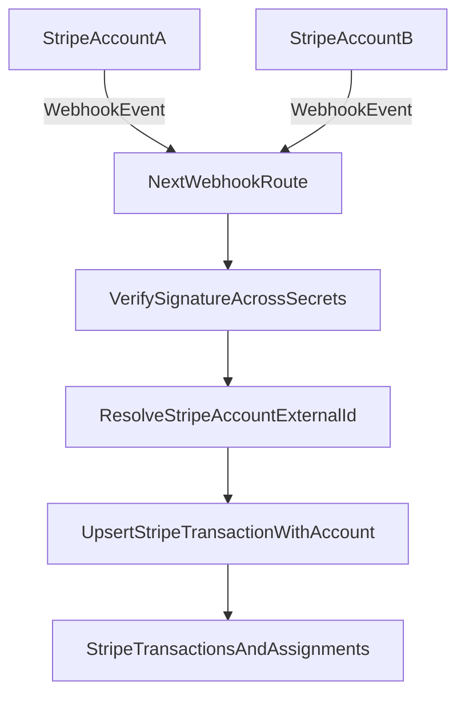

# Guia desde cero: vincular dos cuentas Stripe (sin Connect)

Esta guia explica como configurar **dos cuentas Stripe independientes** (sin Stripe Connect) usando:

- Un solo endpoint webhook: `/api/webhooks/stripe`
- Multiples secretos de firma (uno por cuenta)
- Entornos separados: desarrollo y produccion
- Modelo de datos multi-cuenta ya definido en Supabase (`stripe_accounts`, `stripe_account_id`)

---

## 1) Alcance y arquitectura objetivo

### Estado actual del proyecto

- `src/app/api/webhooks/stripe/route.ts` valida un solo `STRIPE_WEBHOOK_SECRET`.
- `src/lib/stripe/client.ts` instancia un solo cliente Stripe con `STRIPE_SECRET_KEY`.
- `src/lib/stripe/transactions.ts` hace `upsert(..., { onConflict: "stripe_id" })`.
- El schema de Supabase ya esta listo para multi-cuenta y usa unicidad por `(stripe_account_id, stripe_id)`.

### Objetivo final

1. Recibir eventos de ambas cuentas en el mismo endpoint.
2. Verificar firma contra varios secretos.
3. Resolver a que cuenta pertenece el evento.
4. Persistir transacciones con `stripe_account_id`.
5. Hacer upsert idempotente con conflicto compuesto: `stripe_account_id,stripe_id`.



---

## 2) Prerrequisitos

Antes de empezar, confirma:

- Tienes 2 cuentas Stripe (A y B), cada una con sus credenciales test/live.
- Tienes acceso admin al proyecto Supabase.
- El schema de `supabase/schema.sql` aplicado en la DB objetivo.
- Proyecto Next.js ejecutando localmente (`http://localhost:3000`).
- Stripe CLI instalado para pruebas locales (`stripe --version`).

---

## 3) Alta de cuentas en Supabase

Registra cada cuenta Stripe externa en `stripe_accounts`.

```sql
INSERT INTO public.stripe_accounts (stripe_account_external_id, display_name, is_active)
VALUES
  ('acct_xxx_cuenta_a', 'Cuenta A', TRUE),
  ('acct_xxx_cuenta_b', 'Cuenta B', TRUE)
ON CONFLICT (stripe_account_external_id) DO NOTHING;
```

Valida:

```sql
SELECT id, stripe_account_external_id, display_name, is_active
FROM public.stripe_accounts
ORDER BY created_at DESC;
```

Mapeo de cuentas de Stripe:

- `acct_jnode` -> `6b920525-e845-40bc-bb38-8521655c8524` (UUID interno), name: "JNode"
- `acct_vascruz` -> `d1ed4c8a-2eb6-4669-a799-b1c9b31970ae` (UUID interno), name: "Vascruz"

---

## 4) Variables de entorno (dev y prod)

No reutilices una sola variable para todo. Separa por cuenta:

### Propuesta de convencion

```env
# Cuenta A
STRIPE_ACCOUNT_A_EXTERNAL_ID=acct_xxx_cuenta_a
STRIPE_ACCOUNT_A_SECRET_KEY=sk_test_o_live_A
STRIPE_ACCOUNT_A_WEBHOOK_SECRET=whsec_A

# Cuenta B
STRIPE_ACCOUNT_B_EXTERNAL_ID=acct_xxx_cuenta_b
STRIPE_ACCOUNT_B_SECRET_KEY=sk_test_o_live_B
STRIPE_ACCOUNT_B_WEBHOOK_SECRET=whsec_B
```

Variables base existentes que se mantienen:

- `NEXT_PUBLIC_SUPABASE_URL`
- `NEXT_PUBLIC_SUPABASE_PUBLISHABLE_KEY`
- `SUPABASE_SERVICE_ROLE_KEY`

Recomendacion:

- `dev`: guardar en `.env.local`
- `prod`: configurar en secretos del proveedor (Vercel, Render, etc), nunca en repositorio

---

## 5) Ajustes de codigo requeridos para multi-cuenta

El documento es "desde cero", pero para que funcione con tu schema actual debes alinear 3 puntos.

### 5.1 Cliente Stripe por cuenta

Archivo objetivo: `src/lib/stripe/client.ts`

Necesitas exponer un registro de clientes por cuenta (A y B), no un singleton unico.

Resultado esperado:

- Resolver cliente por `stripe_account_external_id`.
- Fallar temprano si falta alguna key requerida.

### 5.2 Verificacion webhook con multiples secretos

Archivo objetivo: `src/app/api/webhooks/stripe/route.ts`

Logica recomendada:

1. Leer `stripe-signature`.
2. Intentar `constructEvent` con secreto A; si falla, intentar con secreto B.
3. Si ninguno valida, responder `400`.
4. El secreto que valido define la cuenta emisora (`acct_xxx...`).

Esto evita ambiguedad y funciona bien para cuentas independientes.

### 5.3 Persistencia con `stripe_account_id`

Archivo objetivo: `src/lib/stripe/transactions.ts`

Debes alinear con schema:

- Incluir `stripe_account_id` en `StripeTransactionInsert`.
- Resolver UUID interno por `stripe_account_external_id` antes del upsert.
- Cambiar conflicto a `onConflict: "stripe_account_id,stripe_id"`.

Si mantienes `onConflict: "stripe_id"` tendras colisiones entre cuentas.

---

## 6) Configuracion de webhooks en Stripe (mismo endpoint)

Repite en **cada** cuenta Stripe (A y B):

1. Ir a `Developers > Webhooks`.
2. Crear endpoint con URL:
   - `dev`: URL publica tunelada hacia local (por ejemplo ngrok) + `/api/webhooks/stripe`
   - `prod`: `https://tu-dominio.com/api/webhooks/stripe`
3. Seleccionar eventos minimos:
   - `payment_intent.succeeded`
   - `charge.succeeded`
   - `checkout.session.completed`
   - `invoice.paid`
   - `customer.subscription.created`
4. Guardar el `Signing secret` de cada cuenta en su variable correspondiente.

Importante: aunque la URL sea igual, **cada cuenta genera su propio `whsec_...`**.

---

## 7) Setup y pruebas en desarrollo

## 7.1 Arranque local

1. Configura `.env.local` con ambas cuentas.
2. Levanta la app local.
3. Asegura que el endpoint webhook sea accesible por URL publica.

## 7.2 Pruebas con Stripe CLI (una sesion por cuenta)

Sesion A:

```bash
stripe listen \
  --api-key sk_test_A \
  --events payment_intent.succeeded,charge.succeeded,checkout.session.completed,invoice.paid,customer.subscription.created \
  --forward-to localhost:3000/api/webhooks/stripe
```

Sesion B:

```bash
stripe listen \
  --api-key sk_test_B \
  --events payment_intent.succeeded,charge.succeeded,checkout.session.completed,invoice.paid,customer.subscription.created \
  --forward-to localhost:3000/api/webhooks/stripe
```

Generar eventos:

```bash
stripe trigger payment_intent.succeeded --api-key sk_test_A
stripe trigger payment_intent.succeeded --api-key sk_test_B
```

## 7.3 Validacion en base de datos

Verifica que se guarda por cuenta correcta:

```sql
SELECT
  st.id,
  st.stripe_id,
  st.transaction_type,
  st.stripe_status,
  st.stripe_account_id,
  sa.stripe_account_external_id,
  st.created_at
FROM public.stripe_transactions st
JOIN public.stripe_accounts sa ON sa.id = st.stripe_account_id
ORDER BY st.created_at DESC
LIMIT 30;
```

Esperado:

- Eventos de A quedan en `acct_xxx_cuenta_a`.
- Eventos de B quedan en `acct_xxx_cuenta_b`.
- Reenvios del mismo evento no crean duplicados indebidos.

---

## 8) Despliegue en produccion

## 8.1 Secrets y configuracion

1. Carga keys y webhook secrets live por cuenta.
2. Nunca mezcles test y live en el mismo entorno.
3. Configura el mismo endpoint URL en ambas cuentas live.

## 8.2 Smoke test post-deploy

Checklist rapido:

- Endpoint responde `2xx` para eventos validos de A y B.
- No hay `400 Invalid signature` para eventos legitimos.
- `stripe_transactions` persiste con `stripe_account_id` correcto.
- El dashboard muestra transacciones de ambas cuentas.

## 8.3 Rotacion de webhook secrets sin downtime

Procedimiento recomendado:

1. Crear secreto nuevo en Stripe (manteniendo temporalmente el anterior).
2. Agregar ambos secretos en backend durante ventana de transicion.
3. Confirmar recepcion normal.
4. Retirar secreto viejo del backend y de Stripe.

Nota: el endpoint debe soportar temporalmente una lista de secretos activos por cuenta.

---

## 9) Runbook de incidentes y troubleshooting

## 9.1 `Invalid webhook signature`

Revisar:

- `stripe-signature` presente.
- Secretos correctos por cuenta y entorno.
- No alteracion del payload antes de `constructEvent`.
- Orden de prueba de secretos en backend.

## 9.2 Evento entra pero no se guarda

Revisar:

- Tipo de evento soportado por `mapStripeEventToTransaction`.
- Moneda (`schema` solo acepta `usd`).
- Errores al resolver `stripe_account_id` interno.
- Error de upsert por conflicto mal definido.

## 9.3 Colisiones/duplicados entre cuentas

Causa tipica:

- Upsert por `stripe_id` global en lugar de `stripe_account_id,stripe_id`.

Accion:

- Corregir `onConflict` y revalidar idempotencia.

## 9.4 Cuenta externa no registrada en `stripe_accounts`

Sintoma:

- No se puede mapear `acct_...` a UUID interno.

Accion:

- Insertar la cuenta faltante en `stripe_accounts`.
- Reprocesar eventos fallidos (desde Stripe dashboard o CLI).

---

## 10) Checklist final "listo para operar"

- [ ] Ambas cuentas registradas en `stripe_accounts`.
- [ ] Variables por cuenta separadas (key + whsec + external_id).
- [ ] Webhook unico configurado en ambas cuentas.
- [ ] Verificacion multi-secreto implementada.
- [ ] Mapeo `external_id -> stripe_account_id` implementado.
- [ ] Upsert por `stripe_account_id,stripe_id`.
- [ ] Pruebas locales exitosas con eventos de ambas cuentas.
- [ ] Smoke test en produccion completado.
- [ ] Runbook de incidentes compartido con el equipo.

---

## Referencias internas del proyecto

- `src/app/api/webhooks/stripe/route.ts`
- `src/lib/stripe/client.ts`
- `src/lib/stripe/transactions.ts`
- `docs/stripe-field-mapping.md`
- `supabase/schema.sql`
